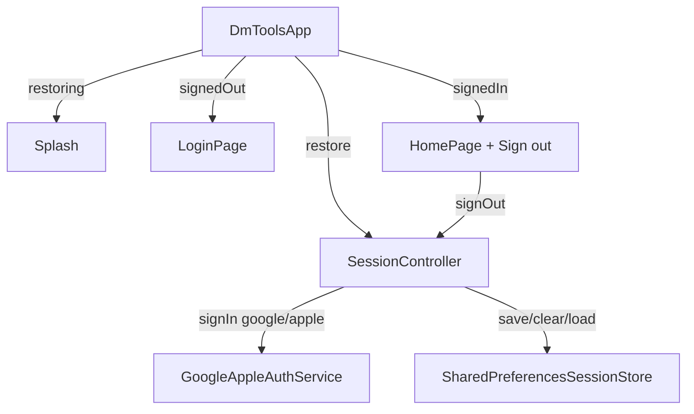

# pr-13: gh-12 Add a login page with Google/Apple sign-in and account remember

## Description

Closes #12
### What changed
Added a login page with Google/Apple sign-in and a remembered account: `SessionController` (ChangeNotifier) orchestrates restore/sign-in/sign-out over an injectable `AuthService` (`google_sign_in` 7.x + `sign_in_with_apple`) and `SessionStore` (`shared_preferences`). App start auto-restores the remembered account, skipping the login page; sign-out clears it.

### Key decisions
- `AuthService` returns `null` on user cancellation (not an exception) so the UI can distinguish "backed out" from "failed"; non-cancellation errors surface as inline login errors
- Platform convention honored via `defaultTargetPlatform`: Apple button on iOS/macOS only, Google button everywhere
- Apple's nullable profile fields (name/email only arrive on first authorization) modeled in `AppUser` (`toJson`/`fromJson` for persistence, nullable fields by design)
- Google sign-out is best-effort and initializes the SDK first — devices without Google services can still sign out of the local session
- `GoogleSignInPlatform`/`SignInWithApplePlatform` instances faked in tests — no plugin channels touched in the suite

### How to verify
```bash
flutter analyze   # clean
flutter test      # 46 tests: model, store, controller, login/home/app flows
```
Widget tests cover the login page (buttons per platform, remember-me, busy/error states), session restore across simulated restarts, and sign-out returning to login.

<details><summary>Architecture</summary>



</details>
