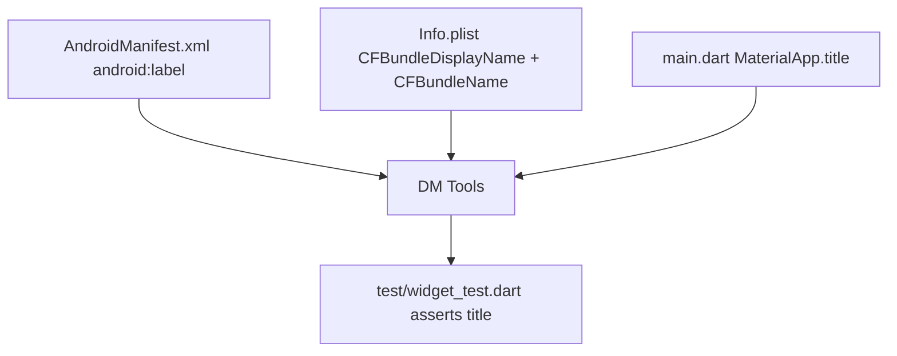

# pr-15: gh-14 Change the app name to "DM Tools"

## Description

Closes #14
### What changed
Renamed the user-visible app name to **DM Tools**: `android:label` in `AndroidManifest.xml`, `CFBundleDisplayName` + `CFBundleName` in `ios/Runner/Info.plist`, and `MaterialApp.title` in `lib/main.dart`.

### Key decisions
- Changed only the app name surfaces listed in the ticket — in-app UI (AppBar text, counter) untouched, satisfying "no other behavior or visual changes"
- Added a widget test asserting `MaterialApp.title == 'DM Tools'` (TDD: written first, failed, then implemented)

### How to verify
```bash
flutter analyze && flutter test
```
Launcher name: inspect `android:label` / `CFBundleDisplayName`, or build and check the home-screen icon label.

<details><summary>Scope</summary>



</details>
