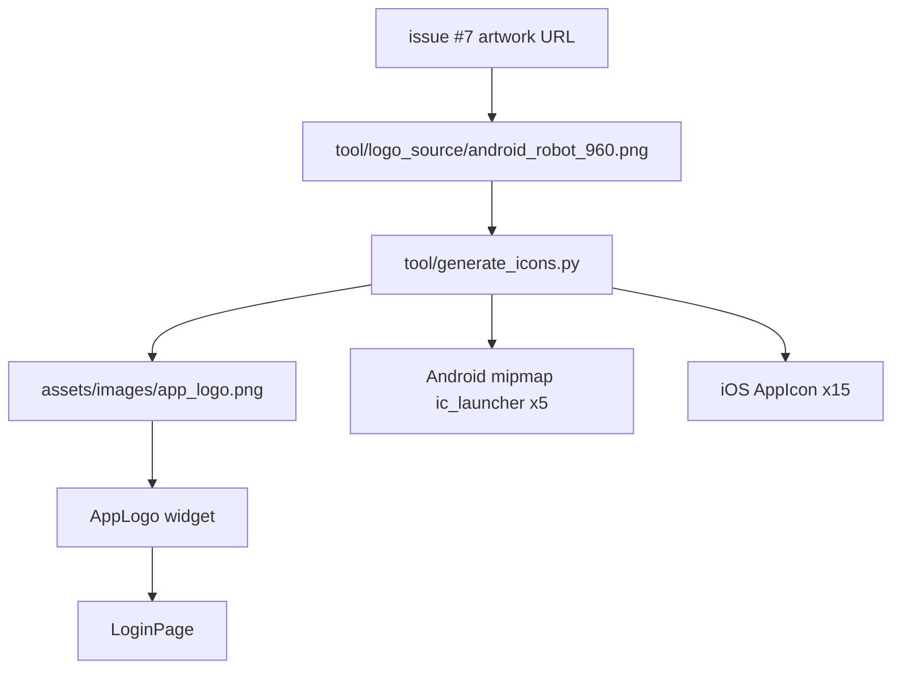

# pr-9: gh-7 Change the app logo to the one in the attachment

## Description

Closes #7
### What changed
Replaced the app logo with the ticket-provided artwork (Android robot, supplied as a URL in issue #7): Android `mipmap` launcher set (5 densities), full iOS `AppIcon.appiconset`, and the in-app logo on the login screen via a new `AppLogo` widget.

### Key decisions
- The requester's link points to a 200px thumbnail; Wikimedia only serves fixed sizes for this file, so the **same SVG** was rendered at 960px (largest served size) and committed under `tool/logo_source/` — regeneration is offline-reproducible via `tool/generate_icons.py`.
- Robot centered on an opaque white square badge: iOS requires an opaque square icon and a uniform badge keeps Android/iOS consistent. Robot artwork and colors untouched.
- In-app logo rendered through `AppLogo` (asset path owned by the widget); rounded corners via `ClipRRect` in-app only — launcher icons stay unrounded squares.
- Android robot is reproduced from work created and shared by Google, used according to the Creative Commons 3.0 Attribution License.

### How to verify
```bash
flutter pub get && flutter analyze && flutter test
```
Logo renders on `LoginPage` (`login_app_logo` widget test); asset ships in the bundle (`test/app_logo_asset_test.dart`); `flutter build apk --debug` succeeds with the new icons.

<details><summary>Architecture</summary>


</details>
